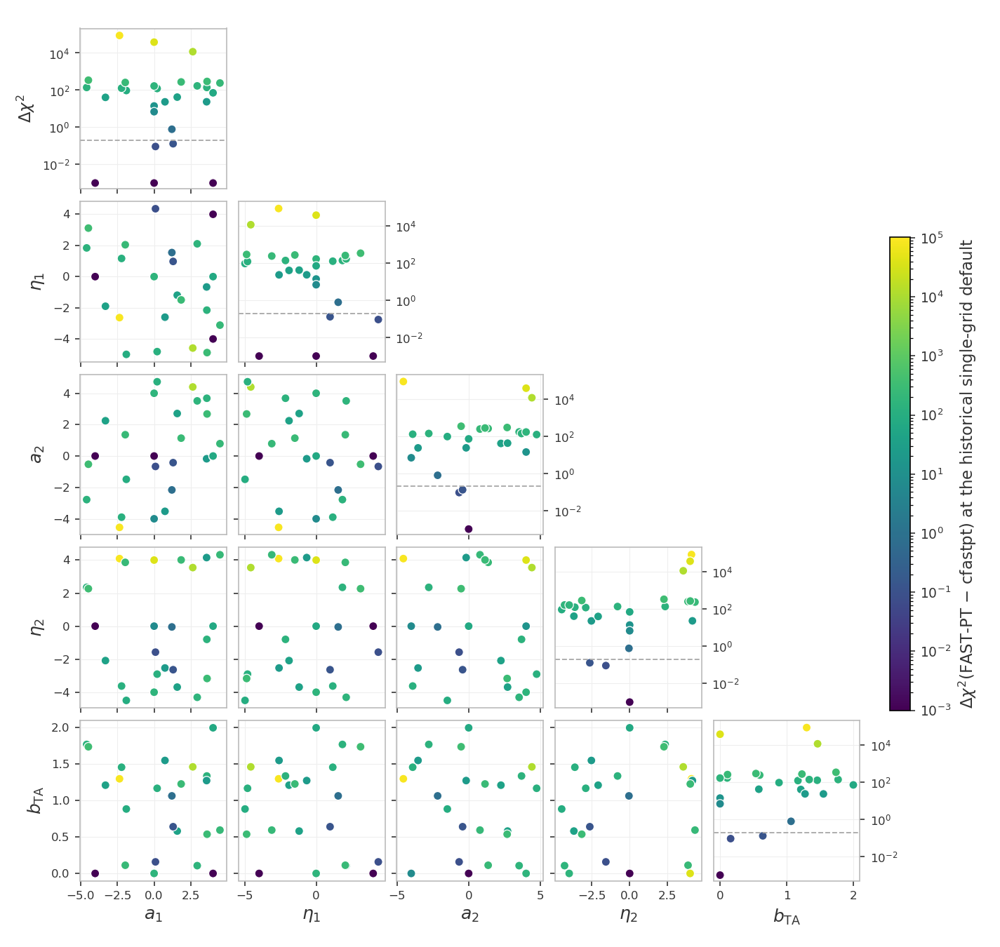
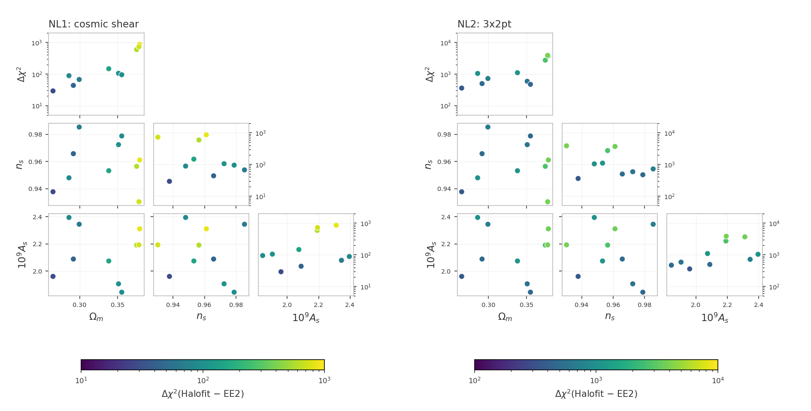
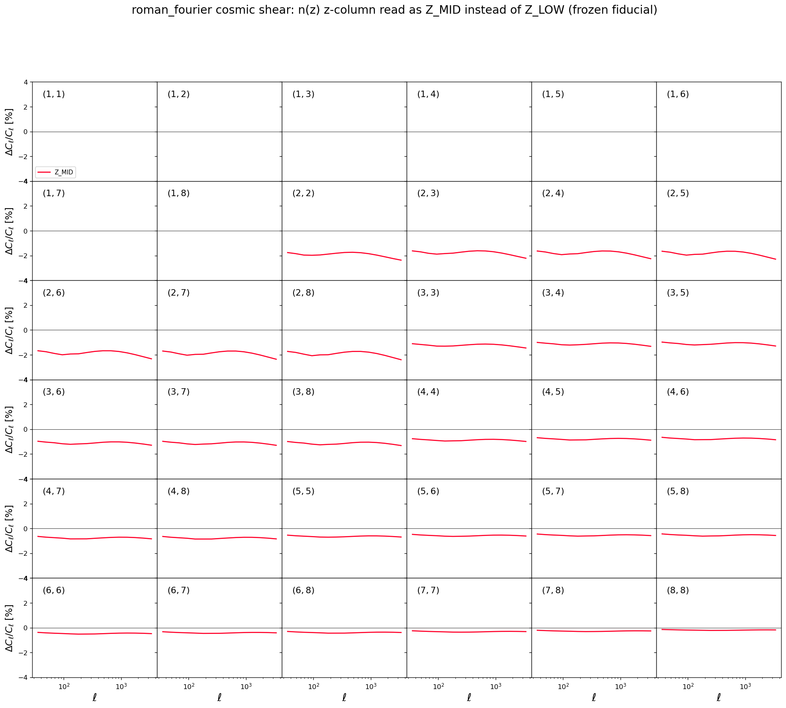
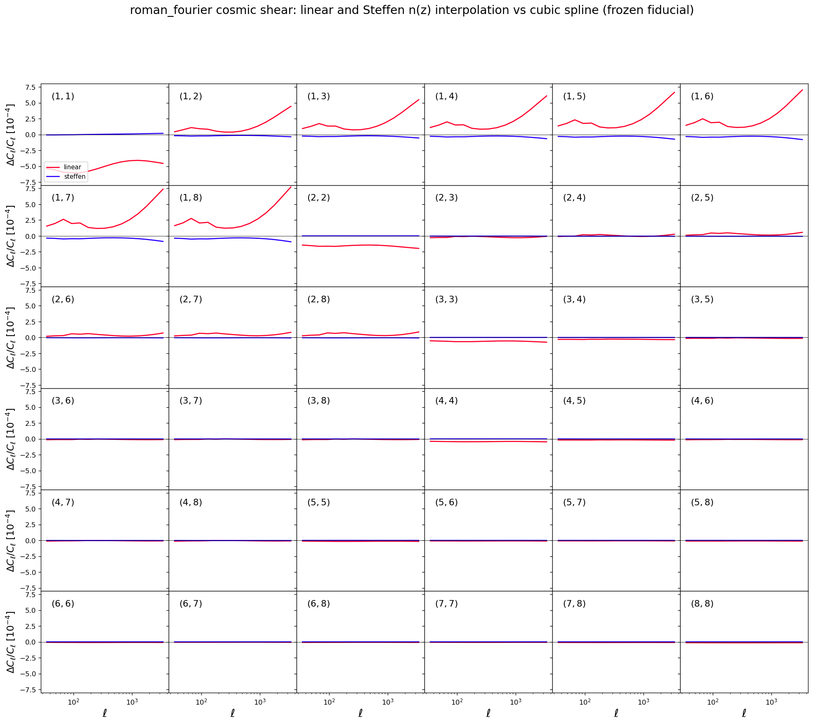

# Unit tests for the likelihoods

The frozen snapshot `frozen/` and its manifest `manifest_sha256.json`
live in the parent `tests/` directory; the paths below are relative to
it.

These tests catch two kinds of silent breakage: a $\chi^2$ that drifted
because code or data changed by accident, and a race condition (a bug
where evaluating several points in a row corrupts a later result
through leftover internal state or colliding OpenMP threads).

Every model build runs in its own worker subprocess. In this project
both examples share one data set, so the isolation is preventive: it
keeps the tests immune to the process abort that different data-set
dimensions trigger inside cosmolike, and every project keeps one
architecture. The commands below stay the same.

The mechanism of every shared check family - the frozen-reference and
race contract, the zero-baseline construction, the sweeps and their
`--high`/`--mask` options, the accuracy settings and their meanings -
is documented once in
[the shared data-vector checks](https://github.com/CosmoLike/cocoa-cosmolike-core/blob/main/README.md#dv_checks)
of the CosmoLike core. This file records what roman_fourier runs and
what it measured.

# Table of contents

1. [Running the tests](#run_tests)
2. [The tests](#the_tests)
    1. [The CFASTPT vs FASTPT comparison](#cfastpt_fastpt)
    2. [The Halofit vs EE2 checks](#halofit_ee2)
    3. [The EE2 race test](#ee2_race)
    4. [Accuracy checks](#accuracy_checks)
    5. [Baryonic feedback checks](#baryon_checks)
    6. [The photo-z convention checks](#photoz_conventions)
    7. [The non-Limber checks](#nonlimber_checks)
    8. [The sector-ladder cache check](#cache_ladder)
3. [Appendix](#appendix)
    1. [FAQ: What does this project's snapshot hold?](#frozen_copy)
    2. [FAQ: How can maintainers refresh the snapshot?](#refreeze)

## Running the tests 

We assume users are in the Conda cocoa environment from a previous
`conda activate cocoa` command, that the shell is bash, and that the
current folder is the cocoa main folder `cocoa/Cocoa`. Every command
below assumes `start_cocoa.sh` has been sourced once:

    source start_cocoa.sh

Run the full suite with

    python -m pytest ./projects/roman_fourier/tests/data_vector

or, without pytest,

    python -m unittest discover -s ./projects/roman_fourier/tests -v

The tests change no project files. Each test prints a progress line
per model build and per evaluation, then a report with the
computed $\chi^2$, the stored reference, the difference, and the pass
limit. A full run performs about 135 likelihood evaluations and takes
a few minutes. The test files force `OMP_NUM_THREADS=4` internally.

## The tests 

The standard configurations get four tests each - the frozen-reference
drift check and the race check, in NLA and in TATT
([mechanism](https://github.com/CosmoLike/cocoa-cosmolike-core/blob/main/README.md#dv_frozen)).
The TATT variants set

    IA_model: 1
    roman_A2_1: 0.05
    roman_BTA_1: 0.05
    roman_A2_2: -1.51541

The suite follows the shared
[test-file naming convention](https://github.com/CosmoLike/cocoa-cosmolike-core/blob/main/README.md#dv_naming): a file name
means the same thing in every project. This project's
configurations and test numbers:

| file | configuration | tests |
|---|---|---|
| `test_example1.py` | cosmic shear | 1-4: drift and race, in NLA then TATT |
| `test_example2.py` | 3x2pt | 5-8: drift and race, in NLA then TATT |
| `test_example2_2x2pt.py` | 2x2pt (`roman_fourier.combo_2x2pt`, the 3x2pt configuration reduced to galaxy clustering plus galaxy-galaxy lensing) | 11-14: drift and race, in NLA then TATT |
| `test_fastpt.py` | the sweep on cosmic shear, the 3x2pt likelihood (`roman_fourier.combo_3x2pt`) and the 2x2pt likelihood (`roman_fourier.combo_2x2pt`) | 15, 16, 17 |
| `test_ee2.py` | cosmic shear, NLA with EE2 (`non_linear_emul: 1`) | 18: race, including EE2's own threaded compute |

Tests 9 and 10 are not used: the numbering follows the shared
convention, where they are the frozen FAST-PT reference checks
this project does not ship.

### The CFASTPT vs FASTPT comparison (`test_fastpt.py`, tests 15-17) 

The sweep mechanism, the zero-baseline construction and the
`--high`/`--mask` options are in
[the shared checks](https://github.com/CosmoLike/cocoa-cosmolike-core/blob/main/README.md#dv_fastpt).
Here, test 15 runs it on cosmic shear, test 16 on the 3x2pt likelihood
and test 17 on the 2x2pt likelihood. In test 16 the frozen
configuration fixes the one-loop bias amplitudes (`roman_B2_*`) at
zero, so the sweep scores the intrinsic-alignment tables alone on the
wider data vector; in test 17 the TATT tables are scored through
galaxy-galaxy lensing alone.

This project's precision needs `accuracyboost: 2`, the doubled output
density. The tests assert there with the 0.2 band of the other checks
as the pass limit, doubling the configuration again as an advisory.

The roman_fourier scale-cut masks `--mask` accepts: `frozen` (the
default) keeps the contract mask (`roman_example.mask`, 1,359 of the
1,485 data points); `ones` keeps every point. The 3x2pt sweep does
not run under `ones` (the Warning below).

> [!NOTE]
> Before the two-grid upgrade of the fastpt theory block (2026-09)
> there was no upsampling and the difference reached
> $\Delta\chi^2 = 87184$ across the prior.

The point values, the design, and the decision record live with the
lsst_y1 project (its tests/README.md carries the full discussion);
the table below is this project's own measurement:

| output table (points) | internal grid (points) | max $\Delta\chi^2$ | Runtime / first row |
|---|---|---|---|
| 1,100 | 1,100 (shared) | 87184 | 1.00 |
| 1,024,900 (`accuracyboost: 1`) | 1,100 | 0.209 | 1.27 |
| 2,048,900 (`accuracyboost: 2`, the pass configuration) | 1,100 | 0.1120 | 1.53 |
| 4,096,900 (`accuracyboost: 4`) | 1,300 (`internal_accuracyboost: 2`) | 0.0828 | 2.00 |
| 8,192,900 | 1,100 | 0.073 | 2.80 |

Runtime ratios use the first row of this table as the baseline, with the
same timed scope and machine. They compare sampling costs within this
project; absolute runtimes depend on the machine.

> [!NOTE]
> This project's precision needs `accuracyboost: 2`, the value its
> example yamls recommend and the tests assert on; the defaults
> land at 0.209, just above the band. cfastpt (`IA_code: 0`)
> remains the reference implementation.

Measured on 2026-09-23:

- Test 16 (3x2pt): max $\Delta\chi^2 = 0.1475$ at the defaults and
  $0.1092$ at the pushed camb/cosmolike settings, above cosmic
  shear's 0.1120 under the 3x2pt masked covariance.
- Test 17 (2x2pt): $0.0021$ and $0.0013$, with the TATT tables
  entering through galaxy-galaxy lensing alone.
- `--mask=ones` (no scale cuts, all 1,485 points weighted): cosmic
  shear repeats its frozen-mask values exactly - the contract mask
  keeps every shear point, so the two masks coincide there - and
  measures 0.0903 at the pushed camb/cosmolike settings; the 2x2pt
  sweep measures max $\Delta\chi^2 = 0.0039$ at the defaults and
  0.0025 pushed.

> [!Warning]
> `--mask=ones` with the 3x2pt likelihood (test 16) fails at model
> build: with every data point kept the shipped
> covariance is not positive definite, and cosmolike aborts
> (`IP::set_inv_cov`). The mask runs with tests 15 and 17.

Run the comparison at the default and at the pushed camb/cosmolike
settings (the full comparison is both invocations):

    python -m pytest ./projects/roman_fourier/tests/data_vector/test_fastpt.py
    python -m pytest ./projects/roman_fourier/tests/data_vector/test_fastpt.py --high=1

### The Halofit vs EE2 checks (`test_nonlinear.py`, NL1-NL2) 

[Mechanism](https://github.com/CosmoLike/cocoa-cosmolike-core/blob/main/README.md#dv_halofit_ee2):
NL1 evaluates the cosmic-shear data vector and NL2 the 3x2pt one, each
with both nonlinear-power sources at the ten shared cosmologies
(halofit, `non_linear_emul: 2`, is the frozen contract's setting).
Measured on 2026-09-23 (the figure below, frozen mask):

- NL1 (cosmic shear): per-cosmology $\Delta\chi^2$ between 29.1
  and 864.7 (median 99.9), largest at the high-omegam draws; under
  `--mask=ones` it repeats these values digit for digit - the
  contract mask keeps every shear point, so the two masks coincide
  there.
- NL2 (3x2pt): between 358.4 and 3876.0 (median 879.8), largest at
  the high-omegam draws; it does not run under `ones` - with every
  data point kept the shipped covariance is not positive definite
  and cosmolike aborts at model build (`IP::set_inv_cov`, the
  Warning above).

Run them on their own (`--mask=ones` reruns them with every data
point kept; NL2 aborts there, the Warning above):

    python -m pytest ./projects/roman_fourier/tests/data_vector/test_nonlinear.py

### The EE2 race test (`test_ee2.py`, test 18) 

[Mechanism](https://github.com/CosmoLike/cocoa-cosmolike-core/blob/main/README.md#dv_ee2):
test 18 is the race check with EE2 sourcing the nonlinear $P(k)$
(`non_linear_emul: 1`) instead of the frozen contract's halofit. The
modification gate, which compiles the pre-modification build (commit
`ff59f66`) at test time and scores the installed build against it,
runs as the lsst_y1 project's test 18 (its `tests/test_ee2.py`); the
emulator build is project-independent, so that comparison is not
repeated here. Measured on 2026-09-23:

- Test 18: the fresh and 10th-in-a-row fiducial agree to all eight
  printed decimals.
- The modified-vs-original comparison of the lsst_y1 gate, run on
  this project's cosmic shear under its frozen mask (ten
  cosmologies), measured max $\Delta\chi^2 = 4.3\times10^{-4}$ (max
  fractional data-vector difference $3.5\times10^{-5}$): the largest
  of the six projects, still far below the 0.2 band.

### Accuracy checks (`test_accuracy.py`, A1-A6) 

[Mechanism, setting meanings and cost order](https://github.com/CosmoLike/cocoa-cosmolike-core/blob/main/README.md#dv_accuracy):
the scan changes one accuracy parameter at a time on the 3x2pt NLA
configuration (the `KNOB` lines of the test output; the measured
values are in the project README under "Minimum accuracy
parameters"); checks A1-A6 then re-evaluate cosmic shear, 3x2pt, and
2x2pt, with NLA and TATT, with every setting pushed far beyond the
defaults at once. This project's pushed values:

| setting | raised to |
|---------|-----------|
| `accuracyboost` (cosmolike) | 3 |
| `integration_accuracy` (cosmolike) | 10 |
| `internal_accuracyboost` (cosmolike) | 2 |
| `kmax_boltzmann` (cosmolike) | 40 |
| `AccuracyBoost` (CAMB) | 2 |
| `k_per_logint` (CAMB) | 50 |
| `kmax` (CAMB) | 50 |

There is no `lmax` entry here: the ell range lives in the dataset.

The nested z-grid construction `accuracyboost` refines is commented in
`likelihood/_cosmolike_prototype_base.py`. The likelihood yamls set
`internal_accuracyboost: 1`, which keeps the convolution grid equal to
the output table: the exact single-grid path. Coarser grids also hold:
the lsst_y1 scan of this setting measured
$`\Delta^T C^{-1} \Delta \le 10^{-9}`$ against the single-grid path
down to `internal_accuracyboost: 0.27`.

#### Why these accuracy defaults? 

The default is `accuracyboost: 2.0` with `pk_z_refinement: 2`. Two grids
of this project need more than `accuracyboost: 1` (measured 2026-10-01):

- The z nodes of the power-spectrum tables. cosmolike interpolates the
  tables linearly in z between their nodes, and at the band centers of
  this Fourier-space data vector that residual does not average out:
  the 3x2pt $\chi^2$ at the synthetic test point moves by 0.25, 0.030
  and 0.002 from 1 to 2, 4 and 8 times the nodes of `accuracyboost: 1`.
  The default has 4 times the nodes: `accuracyboost: 2` doubles them
  and `pk_z_refinement: 2` doubles them again.
- The C-FAST-PT tables of the TATT and one-loop galaxy-bias terms. At
  `accuracyboost: 1` the cfastpt vs FAST-PT comparison of the tests
  (tests 15 and 16) reaches $\Delta\chi^2$ = 0.25 (cosmic shear) and
  0.31 (3x2pt), above the 0.2 band; at `accuracyboost: 2` it is 0.11
  and 0.14.

`accuracyboost` stays global: it multiplies every grid, these included,
and `pk_z_refinement` refines the z nodes alone. Under NLA alone,
`accuracyboost: 1` with `pk_z_refinement: 4` has the same z nodes and
gives a data vector within $\delta^T C^{-1} \delta = 0.005$ of the
default at a lower cost; the TATT tables are what need the boost. The
CAMB request grid stays at 140 redshifts (under CAMB's 256-node cap), so
only the cosmolike tables pay.

The project tag v5.01 shipped `accuracyboost: 1` with
`pk_z_refinement: 4`, which fails the TATT checks above; the default
returned to `accuracyboost: 2` on 2026-10-01.

> [!Warning]
> Do not lower these settings to save computing time: with fewer than 4
> times the z nodes of `accuracyboost: 1`, or with `accuracyboost` below
> 2 under TATT, the error exceeds the 0.2 accuracy budget of the
> reference tests. The likelihood yaml files repeat this next to the
> knobs.

Run them on their own, or skip them (high-accuracy evaluations take
minutes):

    python -m pytest ./projects/roman_fourier/tests/data_vector/test_accuracy.py
    python -m pytest ./projects/roman_fourier/tests --ignore ./projects/roman_fourier/tests/data_vector/test_accuracy.py

### Baryonic feedback checks (`test_accuracy_baryons.py` BF0-BF7, `test_baryons.py` BD1-BD7) 

[Mechanism](https://github.com/CosmoLike/cocoa-cosmolike-core/blob/main/README.md#dv_baryons):
the accuracy checks (BF) report the default-versus-pushed
$\Delta\chi^2$ with each feedback method on; check BF0 also runs the
one-setting-at-a-time scan with the Akino SP(k) feedback on, so a
large delta names the setting causing it. The drift tests (BD) pin
each method's frozen prediction. The BACCOemu point evaluates with
`omegab: 0.049`, inside that emulator's baryon-density training box,
whose floor sits exactly above the fiducial `omegab: 0.04`. Run them
with

    python -m pytest ./projects/roman_fourier/tests/data_vector/test_accuracy_baryons.py
    python -m pytest ./projects/roman_fourier/tests/data_vector/test_baryons.py

### The photo-z convention checks (`test_photoz_conventions.py`) 

[Mechanism](https://github.com/CosmoLike/cocoa-cosmolike-core/blob/main/README.md#dv_photoz):
the frozen cosmic-shear fiducial under the default, each alternative
convention, and the default again. Measured on 2026-09-24:

- default: $\chi^2 = 0.040700$ (the frozen reference exactly).
- linear: $\Delta\chi^2 = 9.4\times10^{-4}$; Steffen:
  $\Delta\chi^2 = 2.9\times10^{-6}$. Either interpolant change is far below
  the survey's statistical precision.
- Z_MID: $\Delta\chi^2 = 3.60$ - the half-bin z-column reading
  is the one photo-z convention that matters at this precision.

The figures below are regenerated by
`generate_photoz_convention_figure.py`:

### The non-Limber checks (`test_nonlimber_ggl.py`, `test_nonlimber_gg.py`) 

[Mechanism](https://github.com/CosmoLike/cocoa-cosmolike-core/blob/main/README.md#dv_nonlimber):
`adopt_limber_gs` and `adopt_limber_gg` are both `0` (non-Limber
below $\ell = 150$) in this project, because the measured differences
below are too large to absorb. In this project's Fourier-space data
vector each band center takes its Limber value plus the non-Limber
correction interpolated linearly between the two integer multipoles
around it.

Galaxy-galaxy lensing, measured on 2026-10-01:

- $\Delta\chi^2 = 1.22$ for the 3x2pt data vector.
- The pairs with lens bin = source bin carry it: (3,3), (2,2), (4,4),
  (1,1), (5,5), (6,6) with 0.72, 0.70, 0.59, 0.49, 0.40, 0.21.
- 1.30 on 2026-09-27, before the band-center correction was computed
  without cosmolike's 1% early exit, at the two integer multipoles
  around each band center only, and before the z nodes of the
  power-spectrum tables were doubled (`pk_z_refinement: 2` on top of
  `accuracyboost: 2`).

On 2026-09-28 the galaxy-galaxy lensing default switched from Limber
to the exact projection: the measured $\Delta\chi^2$ was judged too
large to absorb. The shipped data vector was regenerated with the
non-Limber default and the frozen references were refrozen from it.

Galaxy clustering, measured on 2026-10-01:

- $\Delta\chi^2 = 3.45$ for the 3x2pt data vector, against 1.22 for
  the same comparison in galaxy-galaxy lensing.
- The largest contributions are lens bins 5, 6, 4, 3 with 1.04, 0.90,
  0.82, 0.49 (each bin's block alone).

On 2026-10-01 the clustering default switched from Limber to the exact
projection: the measured $\Delta\chi^2$ (3.34 on 2026-09-28) exceeds
the 1.30 that switched galaxy-galaxy lensing, and clustering had
stayed Limber only because the key preserved the old behavior when it
was introduced. The shipped data vector was regenerated with the
non-Limber default (and `accuracyboost: 2` with `pk_z_refinement: 2`)
and the frozen references were refrozen from it.

### The sector-ladder cache check (`test_cache_consistency.py`) 

The deterministic mixed-update ladder and its bitwise assertions are
described in
[the shared checks](https://github.com/CosmoLike/cocoa-cosmolike-core/blob/main/README.md#dv_cache_ladder).
In this project the ladder takes three cosmology-only steps, then
IA-only, source-photo-z and shear-calibration steps - the lenses are
the source sample, so there is no separate lens-photo-z rung - and
both intrinsic-alignment models run.

## Appendix 

## :interrobang: FAQ: What does this project's snapshot hold? 

The snapshot-protection mechanism is described in
[the shared checks](https://github.com/CosmoLike/cocoa-cosmolike-core/blob/main/README.md#dv_frozen).
This project's `frozen/` holds:

| `frozen/` entry | holds |
|---|---|
| `frozen_config_*.py` | one module per configuration (cosmic shear, 3x2pt, and 2x2pt): the complete cobaya configuration as a yaml string, plus the exact evaluation point |
| `data/` | the tests' own copy of the data vectors, covariance, n(z), and masks |
| `reference_chi2.json` | the six reference $`\chi^2`$ values: cosmic shear, 3x2pt, and 2x2pt, each with NLA and TATT |
| `EXAMPLE_EVALUATE{1,2}.yaml` | snapshots kept only so a human can diff how the live examples drifted since the freeze |

All TATT variants evaluate against `frozen/data/tatt_roman_fourier.dataset`,
the synthetic vector generated at freeze time
([why](https://github.com/CosmoLike/cocoa-cosmolike-core/blob/main/README.md#dv_frozen)).

## :interrobang: FAQ: How can maintainers refresh the snapshot? 

A deliberate change to the data vectors, n(z), covariance, examples,
or likelihood defaults requires a re-freeze.

We assume users are in the Conda cocoa environment from a previous
`conda activate cocoa` command, that the shell is bash, and that the
current folder is the cocoa main folder `cocoa/Cocoa`.

**Step :one:**: activate the private Python environment by sourcing
the script `start_cocoa.sh`

    source start_cocoa.sh

**Step :two:**: rebuild the snapshot

    python ./projects/roman_fourier/tests/generate_frozen_reference.py --overwrite

**Step :three:**: add the feedback vectors of the drift tests

    python ./projects/roman_fourier/tests/generate_frozen_reference.py --baryons

The first command deletes and rebuilds `frozen/` from the current
project, prints the six new reference $\chi^2$ values, and rewrites the
manifest. It does not write the per-method feedback vectors of
`test_baryons.py`; the second command adds them and rewrites the
manifest again. Review the printed $\chi^2$ values against the old
references before committing: they define what every later test run
compares against.
